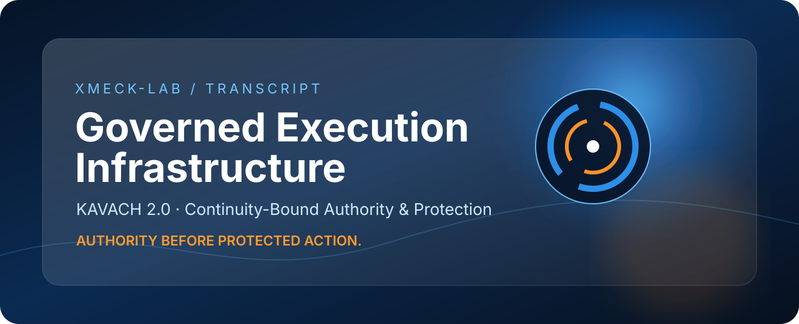
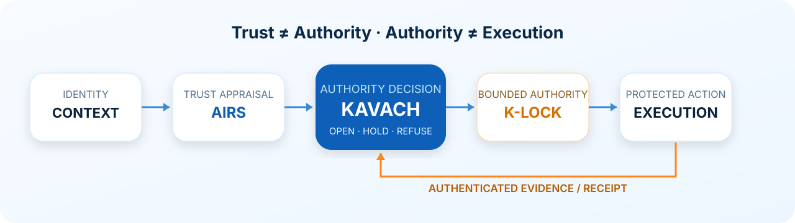
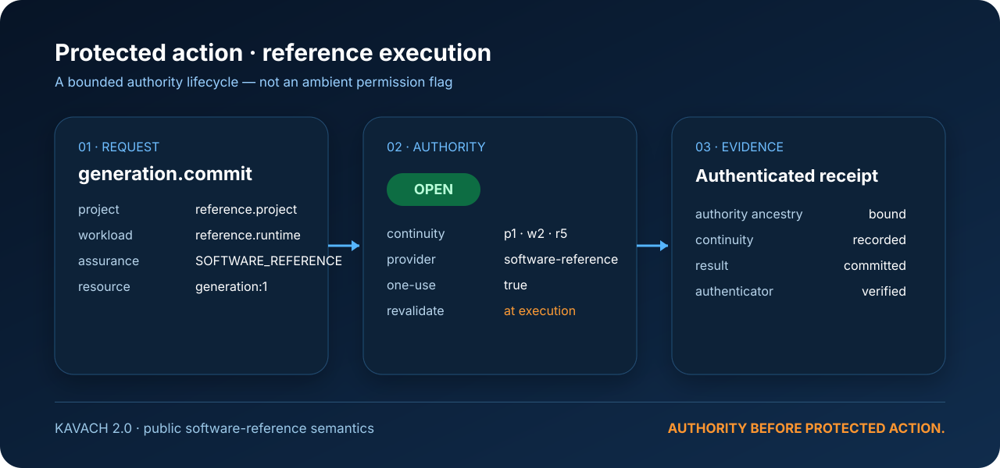

<p align="center">
  
</p>

<h1 align="center">TRANSCRIPT</h1>

<p align="center">
  <a href="https://github.com/XMECK-LAB/TRANSCRIPT/actions/workflows/public-reference-ci.yml"></a>
</p>

<p align="center"><strong>Governed Execution Infrastructure</strong></p>

<p align="center">
  <strong>Authority before protected action.</strong><br/>
  Evidence-backed authority, continuity, execution control, and proof.
</p>

<p align="center">
  <a href="https://github.com/XMECK-LAB/TRANSCRIPT/releases/tag/kavach-v2.0.0"><strong>KAVACH 2.0</strong></a>
  · <a href="KAVACH/README.md">Architecture</a>
  · <a href="KAVACH/docs/QUICKSTART.md">Quickstart</a>
  · <a href="SECURITY.md">Security</a>
  · <a href="LICENSE-NOTICE.md">License notice</a>
</p>

---

## ⚡ What TRANSCRIPT is

**TRANSCRIPT is governed execution infrastructure for software actions that should not proceed on trust alone.**

Its first public subsystem is **KAVACH** — a continuity-bound authority and protection substrate that turns context into an explicit execution decision:

> **Trust ≠ Authority. Authority ≠ Execution. Execution requires current continuity.**

KAVACH evaluates trust context, issues bounded authority, revalidates continuity at execution time, and records authenticated evidence of what happened.

<p align="center">
  
</p>

## 🛡️ KAVACH 2.0 — current public software reference

KAVACH 2.0 is the first publicly admitted subsystem of TRANSCRIPT.

| Capability | Public software reference |
|---|---|
| **Decision semantics** | OPEN / HOLD / REFUSE |
| **Authority binding** | Project, workload, resource, operation, provider, policy, continuity |
| **Continuity** | Project / workload / provider / policy / recovery generations |
| **Execution control** | Revalidation before protected execution |
| **Replay behavior** | One-use authority and consumption semantics |
| **Recovery behavior** | Recovery invalidates stale recovery-dependent authority |
| **Evidence** | Authenticated append-oriented execution receipts |
| **SDK surface** | Bounded reference client; no direct “set OPEN” authority |
| **Provider assurance** | SOFTWARE_REFERENCE |

**Release:** [KAVACH 2.0 — Software Reference](https://github.com/XMECK-LAB/TRANSCRIPT/releases/tag/kavach-v2.0.0)

## 🧠 Why this architecture exists

Many systems collapse trust, authorization, execution, and logging into one decision boundary. KAVACH separates them.

A request can be trusted yet still lack authority. Authority can be valid yet become stale before execution. Recovery can invalidate earlier authority. A receipt should prove the execution lineage rather than merely report that an action happened.

That separation is the engineering idea behind KAVACH:

1. **Appraise context.**
2. **Decide explicitly.**
3. **Bind authority to current continuity.**
4. **Revalidate before execution.**
5. **Emit evidence after execution.**

<p align="center">
  
</p>

## 🚀 Run the public software reference

### PowerShell

```powershell
git clone https://github.com/XMECK-LAB/TRANSCRIPT.git
cd TRANSCRIPT

$env:PYTHONPATH = "$PWD\KAVACH\src"
python -m unittest discover KAVACH\tests
```

### Bash

```bash
git clone https://github.com/XMECK-LAB/TRANSCRIPT.git
cd TRANSCRIPT

PYTHONPATH="$PWD/KAVACH/src" python -m unittest discover KAVACH/tests
```

For the architecture and module map, start with [KAVACH/README.md](KAVACH/README.md).

## ▶️ Executable protected-action demo

The repository includes a real public reference demo, not a screenshot-only mock.

```powershell
$env:PYTHONPATH = "$PWD\KAVACH\src"
python KAVACH\examples\protected_action_demo.py
```

It demonstrates:

**TRUSTED → OPEN → protected execution → recovery continuity change → REFUSE(STALE_CONTINUITY) → verified evidence chain**

See [KAVACH/examples/README.md](KAVACH/examples/README.md).
## 🧩 Repository map

```text
TRANSCRIPT/
├── README.md
├── SECURITY.md
├── LICENSE-NOTICE.md
├── CHANGELOG.md
├── CITATION.cff
├── assets/
│   ├── transcript-kavach-hero.svg
│   ├── authority-flow.svg
│   └── demo-authority-lifecycle.svg
├── docs/
│   ├── ARCHITECTURE.md
│   ├── PUBLICATION.md
│   └── REPOSITORY_MAP.md
└── KAVACH/
    ├── README.md
    ├── PUBLIC-MANIFEST.json
    ├── contracts/
    ├── docs/
    ├── sdk/
    ├── src/
    │   ├── kavach_semantic/
    │   ├── kavach_runtime/
    │   └── kavach_substrate/
    └── tests/
```

See the annotated map: [docs/REPOSITORY_MAP.md](docs/REPOSITORY_MAP.md).

Public maintenance and governance: [docs/OPERATIONS.md](docs/OPERATIONS.md).

## 📦 Public release lines

### KAVACH 2.0 — Software Reference

Current public engineering line with software-reference authority semantics, SDK surface, public tests, contracts, provenance, and source manifest.

[Open KAVACH 2.0 release →](https://github.com/XMECK-LAB/TRANSCRIPT/releases/tag/kavach-v2.0.0)

### KAVACH 1.0 — Engineering Preview

Historical Windows engineering line with a runnable unsigned Windows installer.

[Open KAVACH 1.0 release →](https://github.com/XMECK-LAB/TRANSCRIPT/releases/tag/kavach-v1.0.0)

## 🔬 Engineering boundary

The public repository is intentionally narrower than the private engineering lineage.

**Public today:** the KAVACH 2.0 software reference, its contracts, SDK surface, tests, documentation, and the KAVACH 1.0 historical release line.

**Not asserted by this release:** hardware-backed authority, TPM/TEE/HSM assurance, independent security certification, formal verification, or production certification.

The exact statement is maintained in [KAVACH/docs/CLAIM_BOUNDARY.md](KAVACH/docs/CLAIM_BOUNDARY.md).

## 🔐 Security

Security issues should be reported privately before public disclosure. See [SECURITY.md](SECURITY.md).

## 📜 Publication and license

This repository is public for engineering review, research communication, and product evaluation. **Public visibility is not an open-source license grant.** See [LICENSE-NOTICE.md](LICENSE-NOTICE.md).

## 👤 Independent engineering

**Designed and built by Raaj Mandale.**  
Published under **XMECK-LAB**.

The work represented here comes from an independent systems-engineering program focused on a single question:

> **What should exist between “we trust this” and “the system is allowed to execute this”?**

KAVACH is the executable answer currently published from that program.

