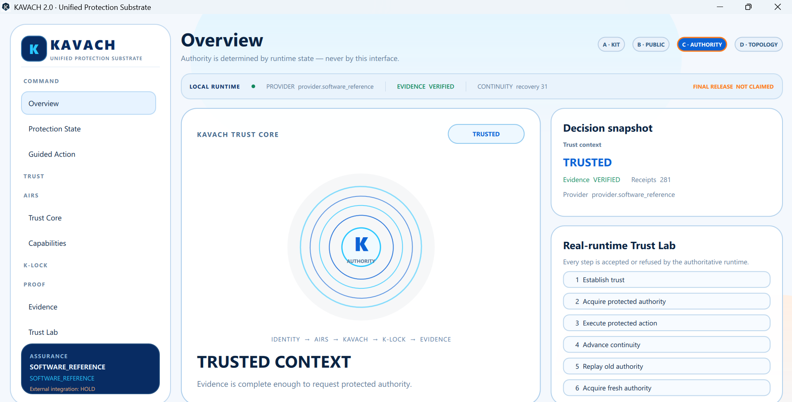
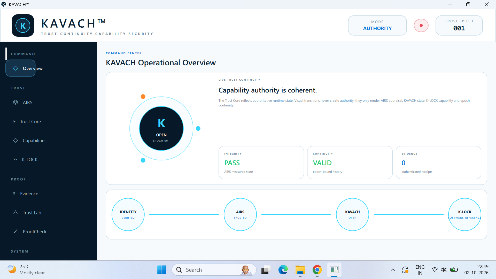

<p align="center">
  
</p>

<h1 align="center">TRANSCRIPT / KAVACH</h1>

<p align="center"><strong>Governed Execution Infrastructure · Authority Before Protected Action</strong></p>

<p align="center">
  <a href="https://github.com/XMECK-LAB/TRANSCRIPT/actions/workflows/public-reference-ci.yml"></a>
</p>

<p align="center">
  <a href="https://github.com/XMECK-LAB/TRANSCRIPT/releases/tag/kavach-v2.0.0"><strong>🛡️ KAVACH 2.0</strong></a>
  · <a href="KAVACH/DOWNLOADS.md"><strong>⬇️ Downloads</strong></a>
  · <a href="KAVACH/VERSIONS.md">Versions</a>
  · <a href="KAVACH/README.md">Architecture</a>
  · <a href="demo/index.html">Demo HTML</a>
  · <a href="SECURITY.md">Security</a>
</p>

---

## ⬇️ Get KAVACH

> **GitHub’s automatic “Source code (zip/tar.gz)” archives contain the Git tree at a tag. They do not contain separately uploaded GitHub Release binaries.**  
> Use the explicit release downloads below when you want the packaged artifact.

| Release line | What it is | Recommended download | Source |
|---|---|---|---|
| **KAVACH 2.0 — Current** | Continuity-bound authority/protection **Software Reference** | **[Software Reference ZIP](https://github.com/XMECK-LAB/TRANSCRIPT/releases/download/kavach-v2.0.0/KAVACH-2.0.0-Software-Reference.zip)** · [SDK ZIP](https://github.com/XMECK-LAB/TRANSCRIPT/releases/download/kavach-v2.0.0/KAVACH-2.0.0-SDK.zip) | [`release/kavach-2.x`](https://github.com/XMECK-LAB/TRANSCRIPT/tree/release/kavach-2.x) · [`kavach-v2.0.0`](https://github.com/XMECK-LAB/TRANSCRIPT/tree/kavach-v2.0.0) |
| **KAVACH 1.0 — Historical** | Runnable Windows Engineering Preview | **[Windows x64 Setup](https://github.com/XMECK-LAB/TRANSCRIPT/releases/download/kavach-v1.0.0/KAVACH-1.0.0-Windows-x64-Setup.exe)** | [`release/kavach-1.x`](https://github.com/XMECK-LAB/TRANSCRIPT/tree/release/kavach-1.x) · [`kavach-v1.0.0`](https://github.com/XMECK-LAB/TRANSCRIPT/tree/kavach-v1.0.0) |

**V1 installer SHA-256**

```text
4CA6D3BB5BE76632EEB53F9A00B123CEE36AFD7A9B365478C82316F733E0275F
```

**Important:** the frozen KAVACH 2.0 release does **not** claim a Windows installer. Its admitted packaged artifact is the software-reference ZIP. See [KAVACH/DOWNLOADS.md](KAVACH/DOWNLOADS.md).

---

## ⚡ What TRANSCRIPT is

**TRANSCRIPT is governed execution infrastructure for software actions that should not proceed on trust alone.**

Its first public subsystem is **KAVACH** — the continuity-bound authority and protection substrate that separates:

> **Trust ≠ Authority ≠ Execution**

and requires current continuity before protected execution.

```text
IDENTITY / CONTEXT
        ↓
       AIRS
  trust appraisal
        ↓
      KAVACH
 OPEN / HOLD / REFUSE
        ↓
      K-LOCK
 bounded authority
        ↓
 execution-time
  revalidation
        ↓
 PROTECTED ACTION
        ↓
 AUTHENTICATED
    EVIDENCE
```

---

## 🛡️ KAVACH 2.0 — current public line

KAVACH 2.0 is the current public **Software Reference / Public Engineering Preview**.

| Capability | Public surface |
|---|---|
| **Decision semantics** | `OPEN` / `HOLD` / `REFUSE` |
| **Authority binding** | project, workload, resource, operation, provider, policy, continuity |
| **Continuity** | project / workload / provider / policy / recovery generations |
| **Execution control** | authority is revalidated before protected execution |
| **Replay behavior** | one-use authority + consumption semantics |
| **Recovery behavior** | recovery invalidates stale recovery-dependent authority |
| **Evidence** | authenticated append-oriented receipts |
| **SDK** | bounded consumer surface; no direct “set OPEN” authority |
| **Assurance** | `SOFTWARE_REFERENCE` |

### ▶️ Executable reference demo

```powershell
git clone https://github.com/XMECK-LAB/TRANSCRIPT.git
cd TRANSCRIPT

$env:PYTHONPATH = "$PWD\KAVACH\src"
python KAVACH\examples\protected_action_demo.py
```

Expected reference path:

**TRUSTED → OPEN → protected execution → recovery continuity advances → old authority REFUSE(STALE_CONTINUITY) → evidence verified**

---

## 🖥️ Product surfaces

These screenshots are **visual evidence of real KAVACH Windows engineering surfaces**. They do not expand the public assurance claim.

### KAVACH 2.0 — runtime-backed Windows surface

<p align="center">
  
</p>

<p align="center">
  <a href="assets/screenshots/kavach-v2/kavach-v2-guided-action.png">Guided Action</a>
  · <a href="assets/screenshots/kavach-v2/kavach-v2-sdk-api.png">SDK / API</a>
  · <a href="assets/screenshots/kavach-v2/kavach-v2-evidence-lineage.png">Evidence</a>
  · <a href="assets/screenshots/kavach-v2/kavach-v2-integrations.png">Integrations</a>
  · <a href="assets/screenshots/kavach-v2/kavach-v2-consumer-admission.png">Consumer Admission Boundary</a>
</p>

### KAVACH 1.0 — historical Windows engineering preview

<p align="center">
  
</p>

Full gallery: [assets/screenshots/README.md](assets/screenshots/README.md)

---

## 🌐 Interactive visual demo

`demo/index.html` is a self-contained HTML/CSS/JS architecture demonstration with a KAVACH Orb/HUD and the authority lifecycle.

It is intentionally a **visual architecture/demo surface**. The authoritative executable proof remains `KAVACH/examples/protected_action_demo.py`.

[Open the demo source →](demo/index.html)

---

## 🧭 Version / source / release model

| Surface | Meaning |
|---|---|
| `main` | current public maintenance, documentation, CI, examples, visual evidence |
| `release/kavach-2.x` | frozen KAVACH 2.0 source projection |
| `kavach-v2.0.0` | frozen KAVACH 2.0 release tag |
| `release/kavach-1.x` | frozen historical KAVACH 1.0 source projection |
| `kavach-v1.0.0` | frozen historical KAVACH 1.0 release tag |
| GitHub Release assets | packaged downloads; **not** automatically embedded in source archives |

See [KAVACH/VERSIONS.md](KAVACH/VERSIONS.md) and [KAVACH/DOWNLOADS.md](KAVACH/DOWNLOADS.md).

---

## 🧩 Repository tree

```text
XMECK-LAB / TRANSCRIPT
│
├── README.md
├── SECURITY.md
├── assets/
│   ├── kavach-orb-hud.svg
│   └── screenshots/
├── demo/
│   └── index.html
├── docs/
│   ├── ARCHITECTURE.md
│   ├── ECOSYSTEM.md
│   ├── OPERATIONS.md
│   ├── PUBLICATION.md
│   └── REPOSITORY_MAP.md
└── KAVACH/
    ├── README.md
    ├── DOWNLOADS.md
    ├── VERSIONS.md
    ├── PUBLIC-MANIFEST.json
    ├── contracts/
    ├── docs/
    ├── examples/
    ├── sdk/
    ├── src/
    └── tests/
```

---

## 🧠 XMECK ecosystem position

```text
XMECK-LAB
└── TRANSCRIPT
    └── KAVACH
        ├── Trust appraisal boundary
        ├── Bounded authority
        ├── Continuity
        ├── Protected execution
        └── Evidence / proof
```

KAVACH is published beneath **TRANSCRIPT**, the governed-execution line. Other XMECK engineering/product lines remain separate unless independently admitted through a real integration contract and implementation.

See [docs/ECOSYSTEM.md](docs/ECOSYSTEM.md).

---

## 🔬 Assurance boundary

The current KAVACH 2.0 public release demonstrates **software-reference semantics**.

It does **not** claim:

- hardware-backed authority;
- TPM / TEE / HSM assurance;
- independent security certification;
- formal verification;
- vulnerability-free operation;
- production security certification.

KAVACH 1.0 is an unsigned historical Windows Engineering Preview.

---

## 👤 Independent engineering

**Designed and built by Raaj Mandale**  
**Published under XMECK-LAB**

The engineering question behind KAVACH is simple:

> **What should exist between “we trust this” and “the system is allowed to execute this”?**

KAVACH is the public executable/reference answer currently published from that program.
