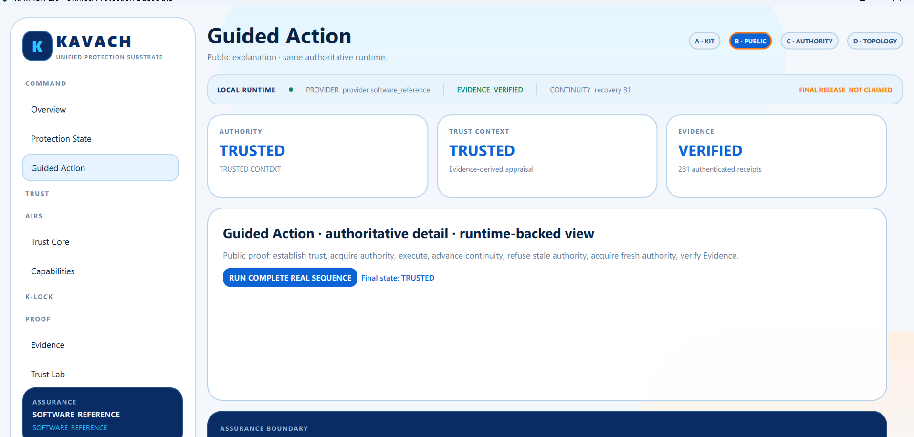
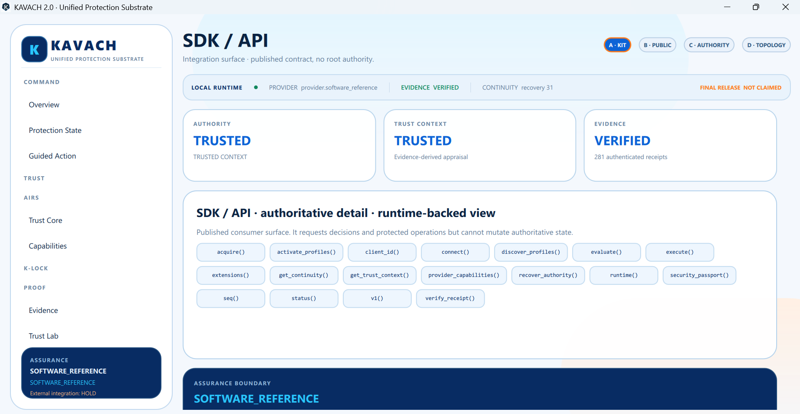
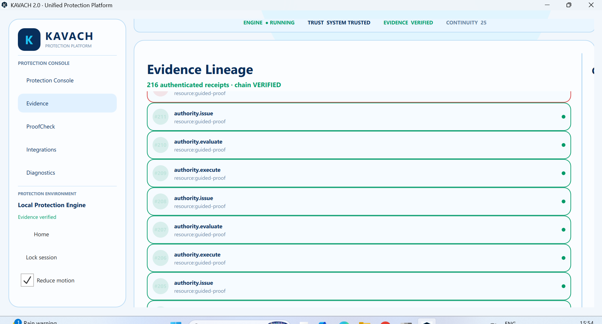
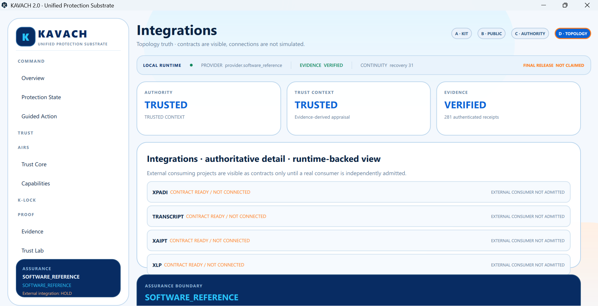
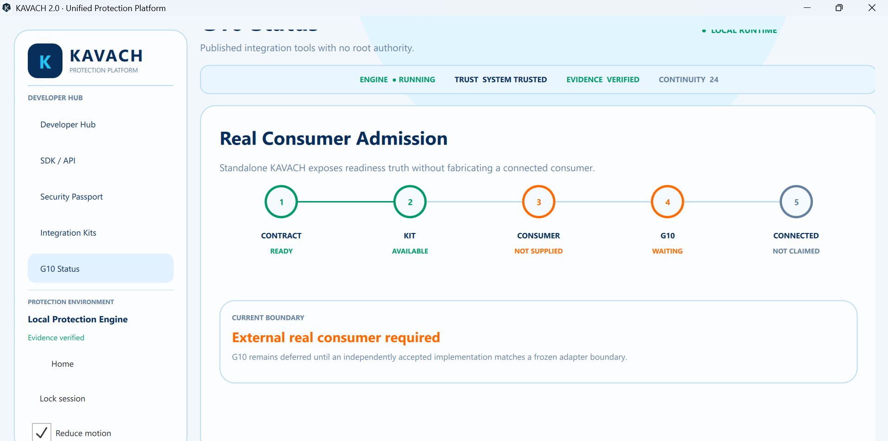
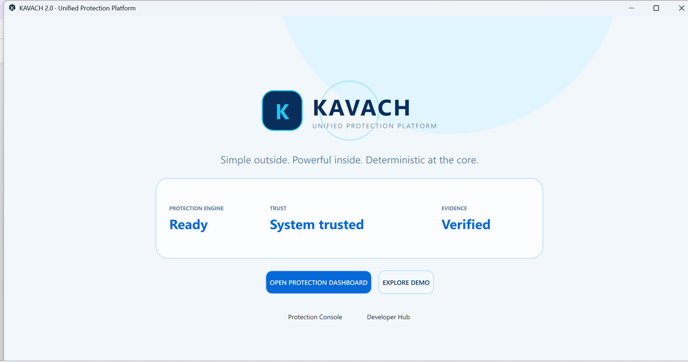

# KAVACH Product Surface Gallery

These images preserve selected real Windows engineering surfaces.

They are **visual evidence**, not security certification.

## KAVACH 2.0

### Overview

### Guided Action

### SDK / API

### Evidence Lineage

### Integrations

### Real Consumer Admission Boundary

### Home / Launch Surface

## KAVACH 1.0

### Historical Operational Overview

## Interpretation

- V1 demonstrates the historical Windows engineering-preview product line.
- V2 screenshots demonstrate later/current Windows engineering surfaces around the software-reference architecture.
- The frozen public V2 release does not claim a Windows installer.
- Screenshots do not expand the published assurance boundary.
